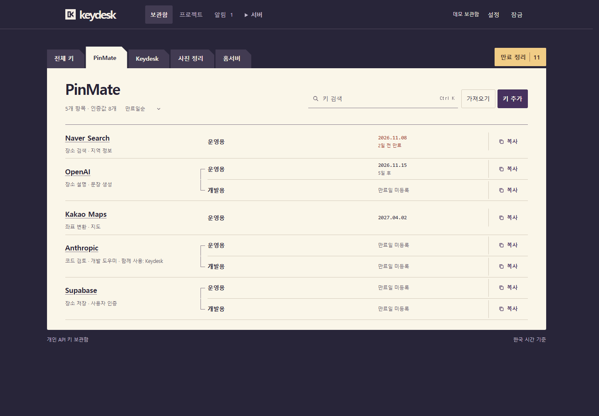
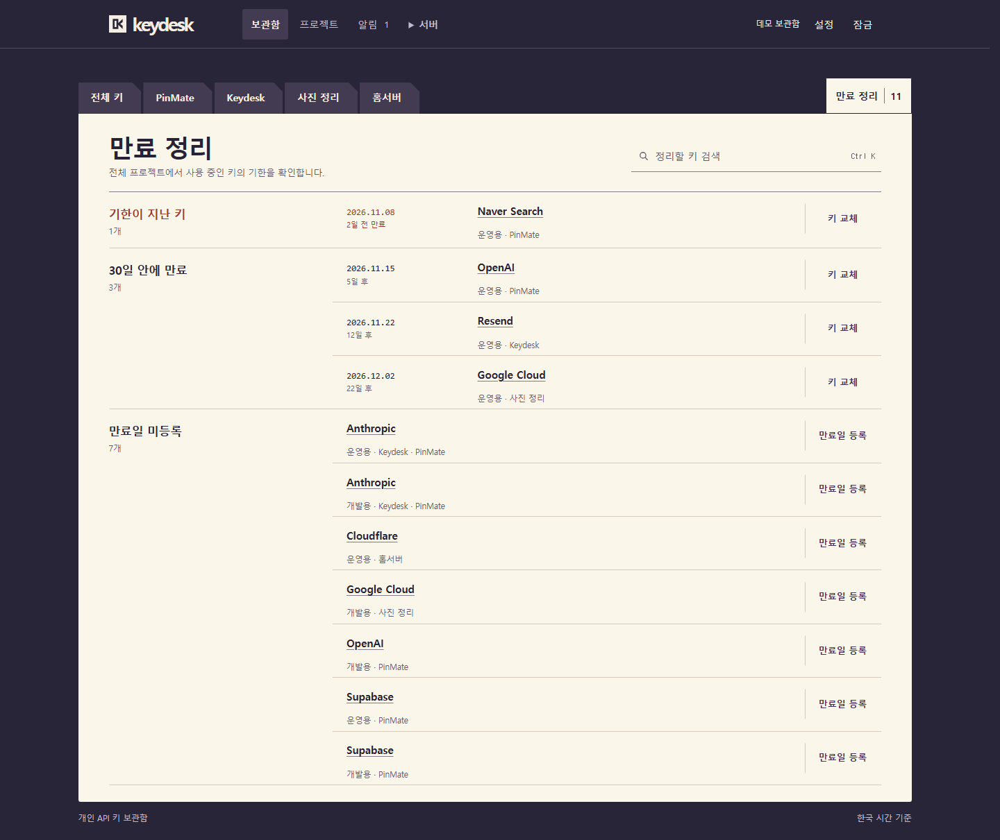
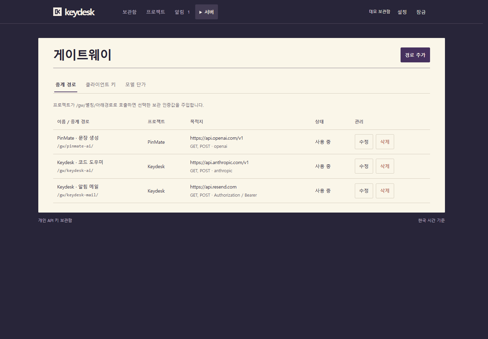
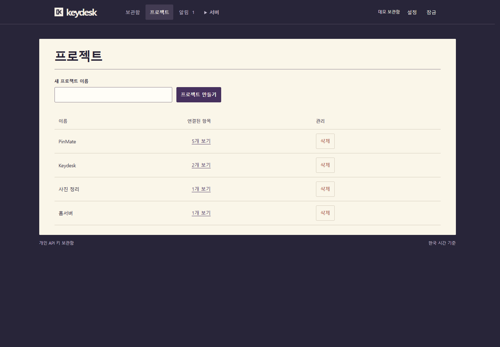
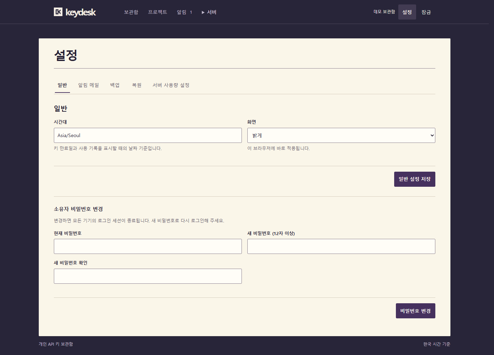
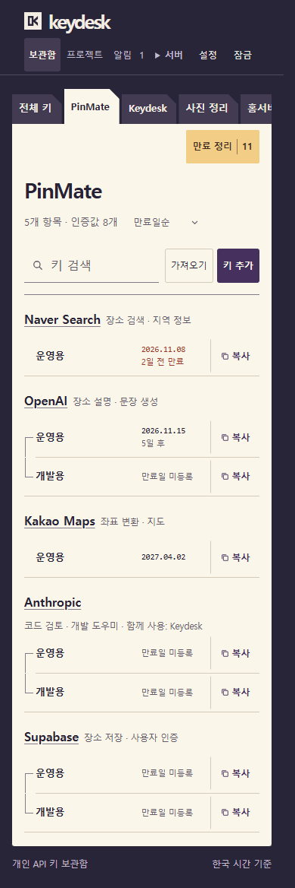

# Keydesk

**프로젝트별로 꺼내 쓰는 개인 API 키 보관함.**

키를 보관하고, 교체할 기한을 챙기고, 프로젝트별 API 호출을 중계하는 한국어 웹 앱입니다.
직접 운영하는 하나의 서버에 보관함을 두고 브라우저에서 사용합니다.

[화면 둘러보기](#화면-둘러보기) · [빠른 시작](#빠른-시작) · [Docker 실행](#docker로-실행) · [운영 안내](docs/운영.md)



모든 화면은 실제 Keydesk에 예시 데이터를 넣어 캡처했습니다. 실제 API 키나 비밀번호 등 인증정보는 포함하지 않았습니다.

보관함·프로젝트·알림·게이트웨이·사용량·설정은 같은 작업면과 글자·버튼·입력 규칙을 사용합니다. 밝은 화면과 어두운 화면을 지원합니다.

## 주요 기능

| 필요한 작업     | Keydesk에서 하는 일                                                                                   |
| --------------- | ----------------------------------------------------------------------------------------------------- |
| 키 찾기와 복사  | 프로젝트별 서랍에서 항목을 찾고, 항목 안의 인증값을 각각 복사합니다.                                  |
| 만료 정리       | 기한이 지난 키, 30일 안에 만료될 키, 만료일이 없는 키를 모아 교체하거나 날짜를 등록합니다.            |
| 가져오기와 이력 | `.env` 파일이나 붙여넣은 내용을 미리 확인해 가져오고, 교체한 키의 이전 버전을 조회합니다.             |
| 호출 중계       | 보관한 인증값으로 중계 경로를 구성하고, 프로젝트와 허용 경로를 지정한 클라이언트 토큰을 발급합니다.   |
| 사용량 확인     | 일일 호출 수를 제한하고 토큰·비용 알림 기준을 설정합니다. 확인한 사용량과 미확인 사용량을 구분합니다. |
| 백업과 복원     | 별도 암호로 보호한 백업을 만들고 복원합니다. 예약 백업 명령으로 보존 개수도 관리합니다.               |

토큰·비용 기준은 **알림 기준**이며 호출을 차단하는 강제 상한이 아닙니다.
게이트웨이 비용은 원래 통화를 보존한 추정치이며, 원화 환산에는 설정한 환율을 적용합니다.
실제 청구액은 제공사의 청구서에서 확인하세요. 보관함의 요금제·한도 메모는 호출 측정값과 별개입니다.

## 화면 둘러보기

### 1. 교체할 키부터 확인

전체 프로젝트의 만료 대상을 한곳에서 보고, 해당 인증값의 교체나 만료일 등록으로 이어갑니다.

<details>
<summary>만료 정리 화면 보기</summary>



</details>

### 2. 프로젝트별 중계 경로 구성

프로젝트, 보관한 인증값, 목적지를 연결합니다. 클라이언트 토큰마다 사용할 경로와 일일 호출 수 제한을 설정할 수 있습니다.

<details>
<summary>게이트웨이 중계 경로 화면 보기</summary>



</details>

### 3. 프로젝트와 설정도 같은 작업면에서

<details>
<summary>프로젝트와 설정 화면 보기</summary>





</details>

### 4. 좁은 화면에서도 같은 보관함

휴대폰에서도 접속 가능한 서버를 운영하면 같은 보관함을 브라우저로 열 수 있습니다.
기기마다 별도로 설치한 보관함 사이에는 자동 동기화가 제공되지 않습니다.

<p align="center">
  
</p>

## 빠른 시작

Node.js **26.12.1**, npm **11.10 이상**을 준비하고 프로젝트 루트에서 실행하세요.

```sh
npm ci
npm run setup
npm run build
npm start
npm run status
```

`setup`은 데이터 저장소와 첫 설정용 토큰을 준비합니다. 소유자 계정은 다음 순서로 직접 등록합니다.

1. 브라우저에서 [http://127.0.0.1:8088](http://127.0.0.1:8088)을 엽니다.
2. `.local/keydesk/bootstrap-token` 파일을 직접 확인해 첫 설정 화면에 입력합니다.
3. 소유자 이름과 12자 이상의 비밀번호를 등록한 뒤 로그인합니다.

토큰 파일은 PowerShell에서 `Get-Content .local\keydesk\bootstrap-token`, macOS·Linux에서 `cat .local/keydesk/bootstrap-token`으로 확인합니다.
토큰과 인증값을 채팅·이슈·화면 캡처에 공유하지 마세요.

기본 데이터 경로는 `.local/keydesk`입니다. 서버를 실행하는 계정만 접근하도록 권한을 설정하세요.
`npm start`는 백그라운드에서 실행하며, 중지는 `npm run stop`으로 합니다. 시스템 재부팅 후 자동 시작은 별도로 설정해야 합니다.

처음에는 키와 프로젝트를 등록하세요. 만료 알림은 앱에서 확인할 수 있고, 메일 알림은 SMTP 설정 후 사용할 수 있습니다.
포트·데이터 경로 변경은 [설정 안내](docs/운영.md#데이터-경로와-포트)를 참고하세요.

## Docker로 실행

Docker Engine과 Compose 플러그인 또는 Docker Desktop을 준비하세요.
[compose.yaml](compose.yaml)은 화면과 API를 하나의 이미지로 빌드합니다. 프로젝트 루트에서 실행합니다.

```sh
docker compose up -d --build
docker compose ps
docker compose exec keydesk node tools/manage.mjs setup --owner
```

마지막 명령에서 소유자 이름과 비밀번호를 직접 등록한 뒤 [http://127.0.0.1:8088](http://127.0.0.1:8088)에서 로그인하세요.
Docker에서는 첫 계정을 컨테이너 내부의 이 명령으로 만듭니다.

SQLite 데이터베이스와 루트 키는 `keydesk-data` 영구 볼륨의 `/data`에 함께 저장됩니다.
기본 포트는 호스트의 `127.0.0.1:8088`에만 공개됩니다. 일반 중지는 `docker compose stop`으로 합니다.
`docker compose down -v`는 영구 데이터를 삭제합니다.

업데이트와 컨테이너 백업 방법은 [Docker 운영 안내](docs/운영.md#docker-운영)에 있습니다.

## 백업과 운영

화면에서 암호화 백업을 내려받거나, 서버를 중지하고 로컬 명령으로 만들 수 있습니다.

```sh
npm run stop
npm run backup -- --output "내 백업.keydesk"
npm start
```

명령은 현재 소유자 비밀번호와 별도의 백업 암호를 숨김 입력으로 받습니다.
백업 암호를 잃으면 복원할 수 없습니다. 복원은 현재 데이터를 교체하므로 대상 경로와 기존 백업을 먼저 확인하세요.

| 운영할 때 필요한 내용          | 안내                                                                      |
| ------------------------------ | ------------------------------------------------------------------------- |
| 시작·중지·업데이트             | [실행 관리](docs/운영.md#시작-중지와-업데이트)                            |
| 다른 기기로 이전하거나 복구    | [백업과 복원](docs/운영.md#백업과-복원)                                   |
| 서버를 중지하지 않는 예약 백업 | [예약 백업과 보존 개수](docs/운영.md#예약-백업과-보존-개수)               |
| 소유자 비밀번호 재설정         | [비밀번호 재설정과 자동화](docs/운영.md#비밀번호-재설정과-자동화)         |
| 외부 게이트웨이와 TLS 설정     | [게이트웨이만 외부에 공개하기](docs/운영.md#게이트웨이만-외부에-공개하기) |

## 개발

```sh
npm run dev
```

API와 화면 개발 서버를 함께 실행합니다. 개발 화면은 [http://127.0.0.1:5173](http://127.0.0.1:5173)이며, 종료는 `Ctrl+C`입니다.

| 명령                | 용도                   |
| ------------------- | ---------------------- |
| `npm test`          | 테스트 실행            |
| `npm run typecheck` | 워크스페이스 타입 검사 |
| `npm run build`     | 웹 빌드와 타입 검사    |

서버는 `apps/server`, 웹은 `apps/web`, 공용 HTTP 형식은 `packages/contracts`, 관리 명령은 `tools`에 있습니다.

## 라이선스

[MIT](LICENSE) · Copyright (c) 2026 thisNorm
