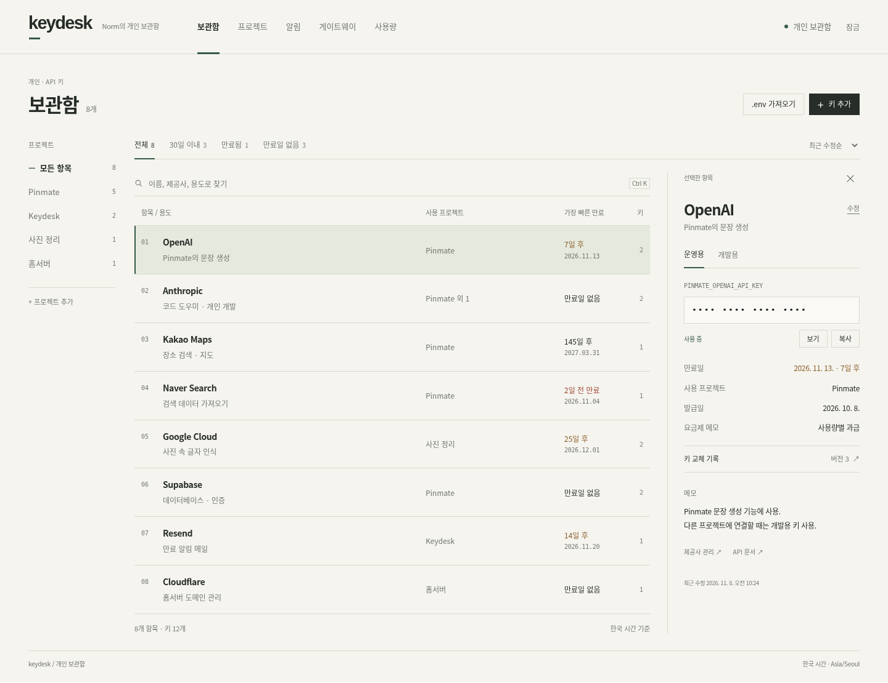
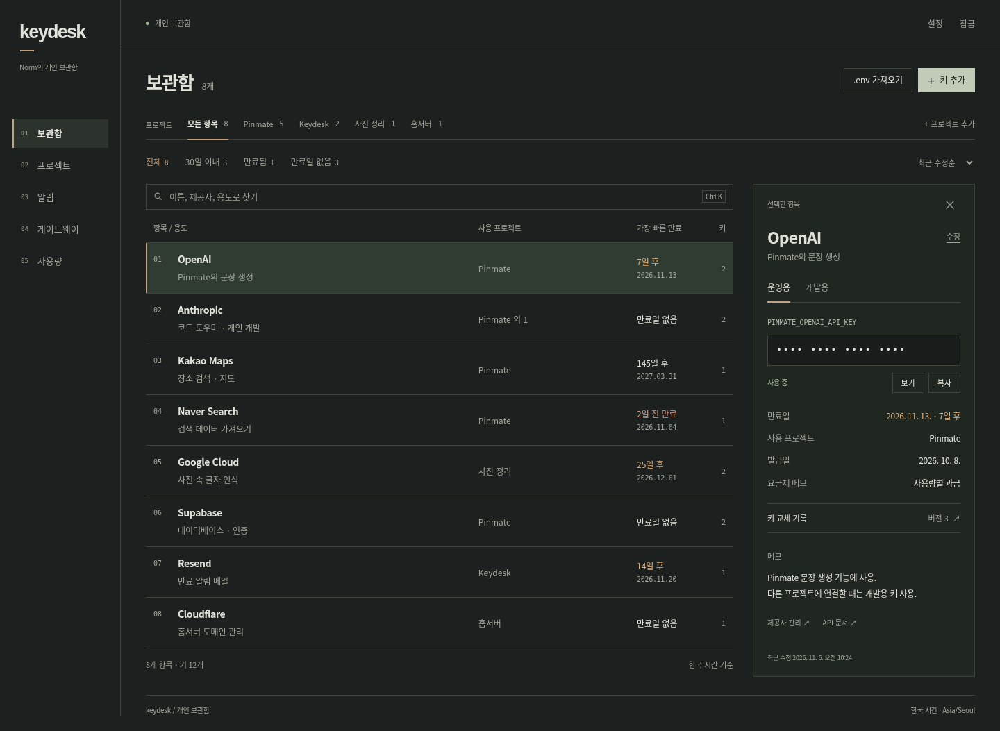
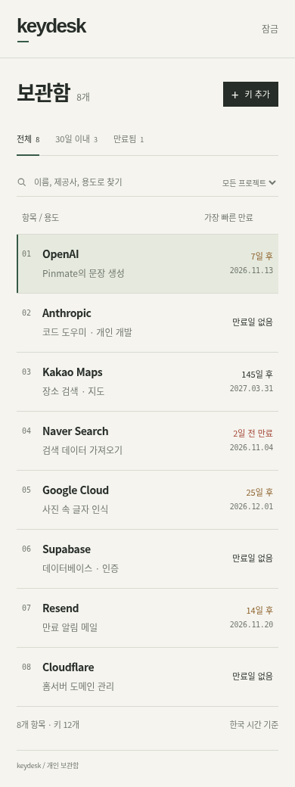

# Keydesk 화면 방향 초안

기능 구현과 별도로 화면 인상을 비교하는 제안이다. 제품 화면에 아직 적용하지 않았다. 모든 데이터는 시안용 예시이며 실제 키나 계정을 사용하지 않는다.

사용자는 한국어로 쓰는 개인 API 키 보관함을 원한다. Windows와 맥북에서 이름·사용 프로젝트·유효기간을 빠르게 확인하고, 필요할 때 값을 복사할 수 있어야 한다. 상시 서버를 갖추기 전에는 보관함이 첫 화면이며 게이트웨이와 비용은 보조 메뉴로 둔다.

## 참고 요청과 접근 결과

요청한 참고 사이트는 [GDWEB](https://www.gdweb.co.kr/sub/list.asp?Txt_fgbn=7)이다. 2026년 11월 6일 이 클라우드에서 해당 주소로 접속을 시도했으나 프록시 터널이 403으로 거부되어 작품 목록을 열람하지 못했다. 아래 안들은 기존 요구와 제품 정보를 바탕으로 직접 만든 초안이다. GDWEB 작품을 확인하거나 특정 작품을 참고한 것으로 표시하지 않는다. 사이트 허용 도메인은 환경 설정 초안에 있지만 적용·게시와는 별개다.

## A · 인덱스 — 우선 추천

따뜻한 흰색, 짙은 잉크색 글자, 낮은 채도의 녹색 선택 영역을 쓴다. 상단에는 제품 메뉴, 왼쪽에는 프로젝트 색인, 가운데에는 키 목록, 오른쪽에는 선택한 항목을 배치한다. 키 이름과 만료일을 같은 줄에서 읽을 수 있게 한다.

큰 통계 카드와 홍보 문구 없이 열 정렬과 가는 구분선으로 구조를 만든다. `keydesk` 글자 아래 짧은 선, 프로젝트 색인과 목록 번호를 반복해 개인용 자료함의 인상을 준다. 넓은 목록과 여백을 사용하는 대신 작은 창에서는 프로젝트 영역을 선택 상자로 전환한다.

## B · 작업대

짙은 녹회색 바탕에 밝은 회색 글자와 절제한 구리색 선을 쓴다. 제품 메뉴는 왼쪽에 고정하고 프로젝트는 목록 위의 가로 탭으로 올린다. 선택한 키는 테두리가 있는 상세 패널에서 확인한다.

어두운 개발 도구와 함께 사용할 때 화면 전환의 눈부심이 적고 프로젝트를 자주 바꿀 때 편하다. 메뉴와 상세 영역이 고정 폭을 차지하므로 A보다 창 너비에 여유가 필요하다. 두 안은 색뿐 아니라 제품 메뉴와 프로젝트를 배치하는 방식이 다르다.

## 공통 동작

- 검색, 프로젝트 필터, 만료 필터와 정렬을 목록 바로 옆에 둔다.
- 제공사 로고, 큰 숫자 카드, 그라데이션, 반복 배지와 홍보 문구를 쓰지 않는다.
- 기본 정보와 키 값을 구분하고 `보기`·`복사`를 명확히 표시한다. 이전 버전은 교체 기록에서 연다.
- 한 항목의 여러 키는 운영용·개발용 탭으로 전환한다. 키 수가 많을 경우 이 부분은 선택 목록으로 바꾸는 후속 검토가 필요하다.
- 만료 여부는 글자와 색을 함께 사용한다. 정확한 한국어 날짜와 상대 일수를 나란히 표시한다.
- 390px 화면은 목록을 먼저 보여주고 항목을 누르면 상세 패널을 연다. 시안에서 가로 넘침이 없음을 확인했다.
- Windows의 `Ctrl K`와 macOS의 `⌘ K`를 구분하고 한글 조합 중 단축키가 실행되지 않게 한다.

[비교용 HTML](ui-draft-2026-11-06.html)은 외부 자원이나 설치 없이 브라우저에서 열 수 있다. 위쪽에서 A/B를 전환하며 검색·필터·항목 선택·상세 열기·보기/숨김을 확인할 수 있다. 나머지 버튼은 의도한 동작을 설명하는 시안이며 서버에 요청하지 않는다.

다음 결정은 A와 B 중 기본 방향의 선택이다. 선택 뒤 글자 크기·목록 밀도·키 추가 및 수정 화면을 구체화하고, 승인된 내용만 실제 제품 UI에 적용한다.
